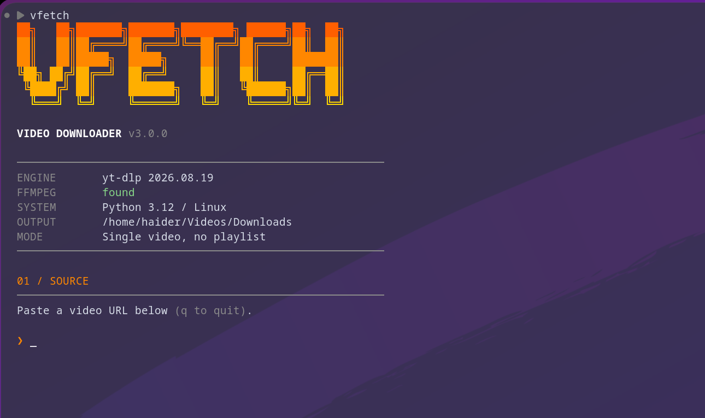

# VFETCH



VFetch is a cross-platform Python 3.9+ terminal front-end for yt-dlp. It supports Windows 10/11, macOS, and Linux, with profiles for best video, audio extraction, and custom format expressions.

## Install

Linux/macOS: `curl -fsSL https://raw.githubusercontent.com/haider-9/VFETCH/main/install.sh | bash`

Windows PowerShell: `irm https://raw.githubusercontent.com/haider-9/VFETCH/main/install.ps1 | iex`

Development install: `python -m pip install .` or `pipx install git+https://github.com/haider-9/VFETCH.git`.

The installers add a `vfetch` command:

- On Windows, it is installed under `%LOCALAPPDATA%\vfetch` and that folder is
  added to your user PATH. Restart PowerShell after installation, or run:
  ```powershell
  $env:Path = [Environment]::GetEnvironmentVariable("Path", "User")
  ```
- On Linux and macOS, it is installed as `~/.local/bin/vfetch`. If
  `vfetch` is not found, add that directory to your shell PATH permanently:
  ```bash
  echo 'export PATH="$HOME/.local/bin:$PATH"' >> ~/.bashrc
  source ~/.bashrc
  ```
  For zsh, use `~/.zshrc` instead:
  ```bash
  echo 'export PATH="$HOME/.local/bin:$PATH"' >> ~/.zshrc
  source ~/.zshrc
  ```

After that, run VFetch from any terminal with:

```bash
vfetch
```

The old bash install is backed up as `~/.local/bin/vfetch.bak-bash` by the installer.
