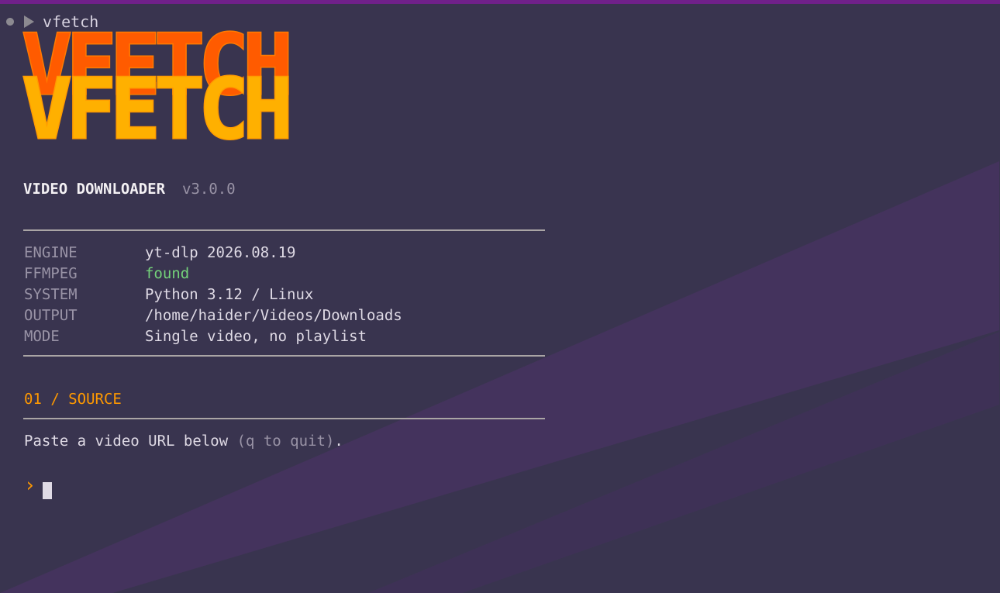

# VFETCH

VFetch is a cross-platform Python 3.9+ terminal front-end for yt-dlp. It supports Windows 10/11, macOS, and Linux, with profiles for best video, audio extraction, and custom format expressions.

## Install

Linux/macOS: `curl -fsSL https://raw.githubusercontent.com/haider-9/VFETCH/main/install.sh | bash`

Windows PowerShell: `irm https://raw.githubusercontent.com/haider-9/VFETCH/main/install.ps1 | iex`

Development install: `python -m pip install .` or `pipx install git+https://github.com/haider-9/VFETCH.git`.

The old bash install is backed up as `~/.local/bin/vfetch.bak-bash` by the installer.
